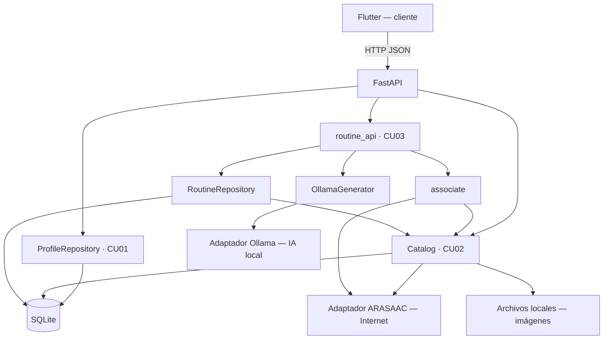

# Arquitectura del MVP — diseño revisado v0.2

> El SRS v0.2 fija el alcance. CU01–CU03 están implementados con evidencia de pruebas. El diseño de CU04–CU05 describe capacidades previstas. Ver [evidencias por iteración](evidence/README.md).

## Componentes



**Límite offline:** Ollama puede ejecutarse sin Internet en el equipo del backend; ARASAAC necesita Internet. Flutter en iPad físico necesita conectarse por red al backend. Los recursos aprobados almacenados localmente pueden reutilizarse cuando ARASAAC no esté disponible.

## Responsabilidades

En Iteración 1, `ProfileGate`/`ProfileEditor` y `ProfileApi` implementan el cliente de CU01; FastAPI expone GET/PUT `/api/v1/profile`. `ProfilePayload` concentra la validación del contrato y `ProfileRepository` el guardado atómico en SQLite. Es la realización inicial de las responsabilidades de perfil del diseño; no se añadieron servicios vacíos para representar componentes futuros. Ver [secuencia CU01](diagrams/cu01-sequence.puml).

- **Flutter:** presentación, edición guiada, validaciones de experiencia de usuario, vista previa/confirmación, navegación mínima.
- **FastAPI:** contratos, validación independiente de frontend, coordinación de operaciones y errores.
- **ProfileRepository y ProfilePayload:** CU01, perfil y contexto.
- **Catalog, rutas de catálogo y ArasaacClient:** CU02, búsqueda local, integración ARASAAC, archivos, categorías y aprobación.
- **routine_api, RoutineApproval y RoutineRepository:** CU03, propuestas, confirmación validada, consultas y persistencia final.
- **associate:** aplicar comparación textual normalizada de acuerdo con la política siguiente; preseleccionar para revisión, **nunca aprobar autónomamente**. No requiere otro modelo de IA.
- **OllamaGenerator:** generación en el servicio local con esquema JSON y validación Pydantic. Solo las pruebas controladas sustituyen el proveedor.
- **SQLite/archivos:** metadatos y relaciones / imágenes; migraciones versionadas.

## Política inicial verificable de asociación de pictogramas (CU03 / RF03.3)

Se requiere un algoritmo **simple y reproducible** para la entrega del 60 %, sin atribuirle precisión semántica que todavía no se ha evaluado:

1. **Normalización solo para comparación:** aplicar `trim`, espacios repetidos → uno, conversión a minúsculas y, para matching, comparación sin tildes; conservar etiquetas originales para la UI. Validar que el `search_term` de IA sea texto no vacío y de longitud acotada antes de consultar servicios.
2. **Local primero:** comparar `search_term` normalizado con etiquetas de pictogramas **ya aprobados**; rango de prioridad `exacta > prefijo > contiene`. Si el máximo nivel incluye **un único resultado**, preseleccionarlo. Si incluye más de uno, **no desempatar por ID**: mostrar alternativas y dejar asociación pendiente de decisión del administrador.
3. **ARASAAC:** si no hay coincidencias locales útiles, consultar la API. El primer resultado devuelto puede mostrarse como **candidato preseleccionado, explícitamente «Sin validar / revisar»**, acompañado de alternativas. No afirmar que es semánticamente correcto ni calcular una confianza ficticia. Si no hay resultados, el paso queda pendiente.
4. **Corrección:** el administrador puede cambiar el candidato por otro guardado, uno obtenido de ARASAAC o una carga propia, y modificar el paso. Una respuesta externa ambigua **nunca se aprueba sola**.
5. **Persistencia:** el candidato externo y la propuesta completa permanecen temporales hasta la confirmación de la rutina. En una única operación lógica registrar recursos nuevos aprobados **desde el formulario de rutina** y sus pasos, compensando archivos temporales si falla la BD. **Excepción intencional:** un pictograma confirmado y guardado por separado en CU02 ya es recurso definitivo aunque luego se cancele el borrador CU03.

**Pruebas imprescindibles:** exacta local gana a API; prefijo gana a inclusión; empate local no se resuelve arbitrariamente; ausencia local consulta ARASAAC; candidato externo sin confirmar no se guarda; error de red deja paso pendiente y habilita resolución manual. La calidad de relevancia real debe medirse con ejemplos, no asumirse por el orden de resultados.

## Contratos REST implementados de CU01 y CU02

| Método | Ruta | Comportamiento |
|---|---|---|
| GET | `/api/v1/health` | Salud, SQLite y entorno |
| GET | `/api/v1/profile` | Consultar perfil confirmado. Devuelve 404 si aún no existe |
| PUT | `/api/v1/profile` | Reemplazar alias y contexto del perfil único |
| GET | `/api/v1/pictograms` | Listar recursos aprobados, con filtro opcional `category_id` |
| GET | `/api/v1/pictograms/search` | Buscar con `q`, `category_id` y `alternatives`. Devuelve `local`, `alternatives` y `remote_status` |
| GET | `/api/v1/pictograms/arasaac/{id}/image` | Obtener vista previa externa sin incorporar el candidato |
| POST | `/api/v1/pictograms` | Incorporar mediante JSON con `confirmed: true`, etiqueta, categorías opcionales y una referencia `external_id` o un archivo `image_base64` |
| PUT | `/api/v1/pictograms/{id}` | Reemplazar etiqueta y asociaciones de categorías |
| GET | `/api/v1/pictograms/{id}/image` | Servir el archivo administrado por el catálogo |
| DELETE | `/api/v1/pictograms/{id}` | Eliminar recurso y archivo. Devuelve 409 ante una dependencia restrictiva |
| GET / POST | `/api/v1/categories` | Listar o crear categorías |
| PUT / DELETE | `/api/v1/categories/{id}` | Renombrar o eliminar una categoría. El borrado conserva los pictogramas |

Consultas y actualizaciones correctas devuelven 200, creaciones de catálogo devuelven 201 y borrados devuelven 204. Los detalles de validación, origen y almacenamiento se describen en los [contratos de CU01](evidence/iteration-1/design.md) y [CU02](evidence/iteration-2/design.md).

## Contratos REST implementados de CU03

| Método | Ruta | Comportamiento |
|---|---|---|
| POST | `/api/v1/routines/proposals` | Generar y asociar en memoria desde `description`. Devuelve 200 con candidatos para revisión |
| GET / POST | `/api/v1/routines` | Listar rutinas o crear una desde pasos con aprobación individual y confirmación explícita. Creación devuelve 201 |
| GET / PUT / DELETE | `/api/v1/routines/{id}` | Consultar, reemplazar o eliminar una rutina guardada. Borrado devuelve 204 y preserva pictogramas |

La entrada y salida, límites y errores se detallan en los [contratos de CU03](evidence/iteration-3/design.md). Las propuestas usan contexto confirmado pertinente, sin alias. El servidor devuelve 502, 503 o 504 ante salida inválida, indisponibilidad o timeout de IA.

## Salida estructurada del modelo de IA

Ejemplo **ilustrativo**, validado siempre por Pydantic en el backend:

```json
{
  "name": "Prepararse para el colegio",
  "steps": [
    {"order": 1, "label": "Levantarse", "search_term": "levantarse"},
    {"order": 2, "label": "Desayunar", "search_term": "desayunar"}
  ]
}
```

El modelo propone palabras/pasos, **no selecciona definitivamente imágenes ni almacena datos**.

## Consistencia de guardado

- Las propuestas viven en memoria/estado del cliente, no como contenido aprobado.
- Una rutina se confirma solo si nombre/pasos/pictogramas cumplen las reglas.
- Las llamadas a Ollama y ARASAAC concluyen antes de abrir la unidad de escritura.
- La confirmación comparte conexión SQLite para rutina, pasos y pictogramas nuevos.
- La unidad de escritura de `Catalog` registra los archivos que crea y los elimina si falla la transacción. La reconciliación de arranque trata residuos gestionados de interrupciones.
- `ON DELETE RESTRICT` protege pictogramas referenciados por pasos. El borrado de rutina elimina pasos en cascada y conserva pictogramas. El borrado de categoría disocia sin borrar recursos.

## Calidad y despliegue

- **Dev:** configuración local y BD de desarrollo.
- **Test:** BD aislada, mocks/fakes para ARASAAC e IA en pruebas automatizadas; **smoke test real** aparte para Ollama y para ARASAAC cuando haya conectividad.
- **Demo/release:** build Flutter y backend versionados, configuración definida, instrucciones reproducibles, respaldo y evidencias. No afirmar que existe «producción» real hasta que el procedimiento se haya probado.
- Pruebas: unitarias por reglas, integración API/SQLite, integraciones externas controladas, prueba end-to-end manual y demostración de IA real.

## Riesgos abiertos

1. Rendimiento/calidad del modelo local en hardware disponible.
2. Calidad de la coincidencia textual ARASAAC y ambigüedades de términos.
3. Condiciones de uso, atribución y redistribución de los pictogramas ARASAAC (verificar en la integración).
4. El rollback y la reconciliación de archivos se probaron con fallos controlados. El comportamiento ante fallos del dispositivo de almacenamiento sigue siendo una limitación operativa.
5. Compatibilidad real con iPad físico y conectividad al backend.

## UML e instalación de la entrega

- [Diagrama de casos de uso](diagrams/use-cases.puml) y [secuencia de CU03](diagrams/cu03-sequence.puml): archivos fuente PlantUML para incorporar a la presentación; no representan ejecución verificada.
- [Plan de pruebas](test-plan.md): escenarios unitarios, de integración y evidencia de inferencia real.
- La guía exacta de instalación **se redactará a partir del procedimiento probado**. El entorno «demo/release» debe distinguirse de desarrollo y de test, con variables de configuración y base de datos propias. No confundir build de demostración con una producción pública desplegada.

La [implementación de CU02](evidence/iteration-2/design.md) incorpora el catálogo, el adaptador ARASAAC y el almacenamiento de imágenes junto a la base de cada entorno.
