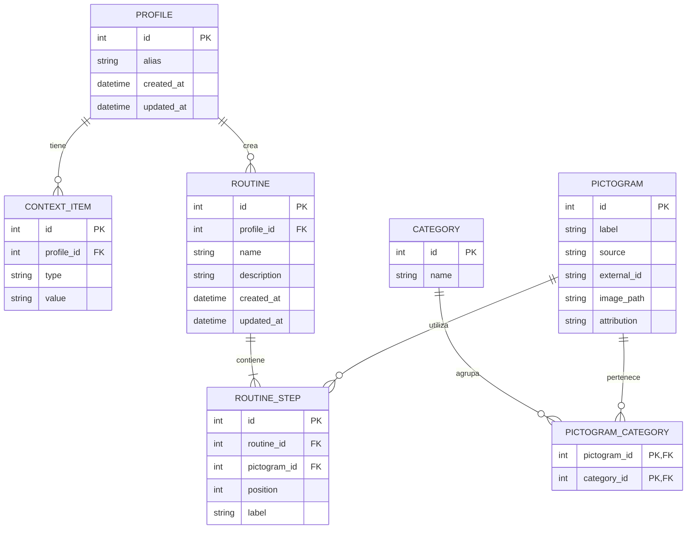

# Modelo de datos del MVP — diseño conceptual v0.2

**Estado:** Profile y ContextItem implementados y probados automáticamente en Iteración 1. Pictogram, Category y PictogramCategory se incorporaron en la migración 002 de CU02. Routine y RoutineStep permanecen en el modelo conceptual para CU03.

## Entidades y decisiones

| Entidad | Atributos/restricciones importantes |
|---|---|
| `Profile` | Único perfil activo en este MVP; alias 1–50 |
| `ContextItem` | `type` en `INTEREST`, `ACTIVITY`, `ROUTINE`; valor 1–50; combinación única de perfil, tipo y valor normalizado |
| `Category` | Nombre 1–50, único tras normalización |
| `Pictogram` | Origen `ARASAAC` o `CUSTOM`, etiqueta, ruta de imagen gestionada por servidor, referencia externa y atribución cuando aplique |
| `PictogramCategory` | Relación N:M, clave compuesta (`pictogram_id`, `category_id`); **categoría opcional** |
| `Routine` | Nombre no vacío, perfil propietario; debe persistirse con ≥1 paso |
| `RoutineStep` | Posición única por rutina, un pictograma existente por paso, etiqueta contextual opcional; mismo pictograma puede repetirse |

## Restricciones de integridad

- `UNIQUE(source, external_id)` cuando `external_id` no sea `NULL`, evitando duplicados ARASAAC.
- `UNIQUE(routine_id, position)`; todas las posiciones deben ser números válidos; la secuencia ordenada es visible en CU03.
- `FOREIGN KEY (pictogram_id)` de pasos con eliminación restringida; eliminar rutina sí elimina sus pasos.
- Eliminar categoría quita sus relaciones con `PictogramCategory` y **no** elimina pictogramas.
- No agregar pictogramas externos candidatos durante preselección de CU03; persistir solo al confirmar.
- Los nombres normalizados pueden almacenarse en columnas técnicas o verificarse en servicio más índice único; implementar coherentemente en SQLite.
- Activar y comprobar `PRAGMA foreign_keys = ON` en conexiones SQLite.

## Distinciones semánticas

`ContextItem(type='ROUTINE')` significa **preferencia declarada** como «mañana»; `Routine` significa **secuencia visual editada y validada** en CU03. No confundir ambas entidades ni asumir que son el mismo recurso.

## Ejemplo N:M

«Agua» es un solo registro `Pictogram`; puede asociarse con «Alimentación» e «Higiene» mediante dos filas `PictogramCategory` y aparecer en dos pasos de una rutina mediante referencias de `RoutineStep`.

## Pendiente técnico

CU01 utiliza sqlite3 y migraciones SQL numeradas, registradas mediante PRAGMA user_version (ADR-018). La migración `backend/scaa_backend/migrations/001_profile_context.sql` crea el perfil único y sus elementos de contexto. La clave `value_key` utiliza casefold y un índice único por perfil, tipo y valor normalizado. Las convenciones del resto del modelo y el manejo de archivos se concretarán al implementar los siguientes casos de uso.

El contrato de perfil devuelve solo `id`, `alias`, `interests`, `activities` y `frequent_routines`. Los metadatos operacionales internos de la tabla no se exportan como registros documentales. `ContextItem(type='ROUTINE')` sigue representando contexto declarado; no es una rutina visual de CU03.

## Escenarios de integridad a verificar

| Escenario | Resultado esperado |
|---|---|
| Pictograma «Agua» en «Alimentación» y «Higiene» | Un solo `Pictogram`, dos filas de `PictogramCategory` |
| Borrar categoría «Higiene» | Se elimina la asociación, no el pictograma ni la categoría «Alimentación» |
| Dos pasos con el mismo pictograma | Permitidos en una o varias rutinas, con posiciones diferentes |
| Borrar pictograma referenciado | Rechazado por FK o regla de servicio |
| Propuesta CU03 no confirmada | No aparecen nuevas rutinas ni pictogramas en tablas definitivas |
| Confirmar rutina con pictograma externo | Crear recurso validado y pasos en transacción; limpiar archivo temporal ante error |

**Aclaración:** `Pictogram` almacenado equivale a recurso aprobado; el modelo no contiene una «aprobación» automática. Una preselección de ARASAAC es dato transitorio, no una fila definitiva.

La [implementación de CU02](evidence/iteration-2/design.md) detalla la representación del origen, la atribución, el archivo local y las asociaciones.
